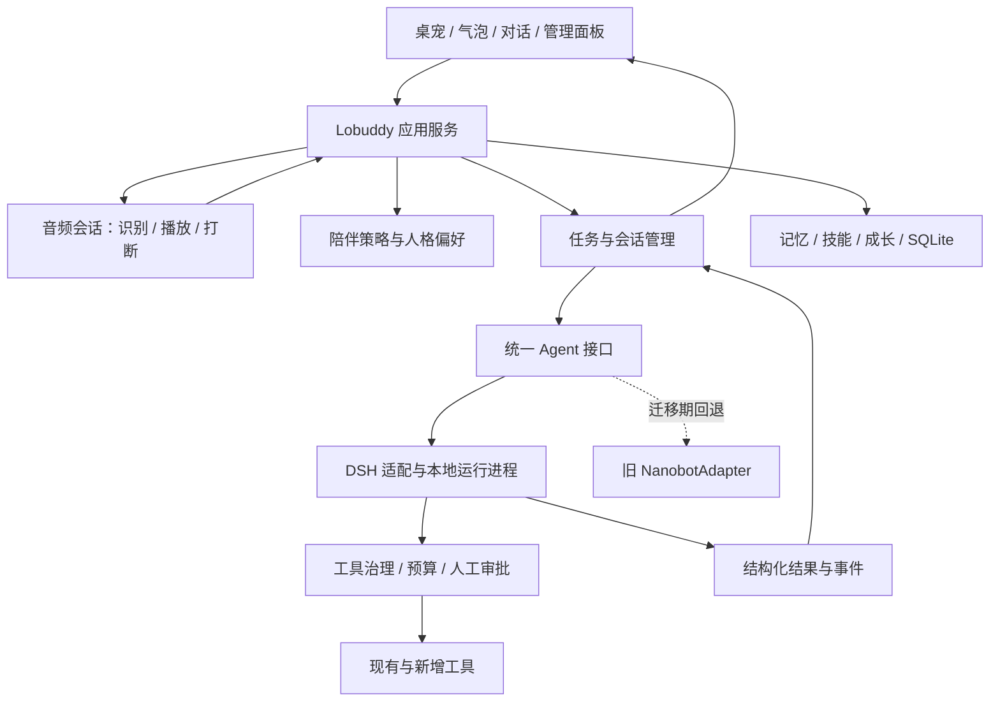

# Lobuddy 10.15 整体升级计划：DSH 底座与桌宠陪伴重构

计划批次：10.15。实际编写及资料核对日期：2026-10-16。

状态：待实施；本文不代表 DSH 已接入、旧功能已迁移或测试已通过。

本地文档基线：`fb2b501`；前次源码扫描基线：`9a27479`。

范围：Agent 底座、领域与运行时边界、桌宠 UI、语音陪伴、长期记忆、旧功能和数据迁移。

## 1. 升级目标与已确认的产品方向

使用 DeepSeek Harness（DSH）逐步替换 nanobot，参考 FeiZ 的 DeepSeek Bot（DS Bot），对 Lobuddy 做整体重构，保留现有大部分功能。用户认可现有产品思路，主要希望改善架构、UI 和整体使用体验；不能将本次目标缩减为一个只有聊天和语音的新桌宠。

本计划中的“DSH dot 方向”指前述 DS Bot 参考项目，不把它当作另一个已经核实的官方产品名称。DSH 是运行底座，DS Bot 是参考插件，Lobuddy 是最终面向用户的桌面产品。

已确认的体验约束：

1. 桌宠具有陪伴价值；用户目前主要使用 Codex，没有每天必须交给 Lobuddy 的固定任务。
2. 沿用用户当前喜欢的浊蒂宠物外形；只借用外形，不导入原角色的完整人格、背景或关系设定。
3. 初始性格温柔、自然、有好奇心；通过共同经历与明确反馈逐渐形成互动习惯，允许用户纠正。
4. 偶尔主动找用户，默认先冒气泡。未开启语音陪伴时不主动出声、不持续采集麦克风。
5. 用户开启语音陪伴后可连续自然对话，支持插话打断，也能安静陪伴；逐句按键说话只能作为调试或备用方式。
6. 声音以用户试听选中的 [Fish Audio「甜甜的台灣女孩」](https://fish.audio/m/e4a66454f7a44f63a2cc9e8c044d701d/) 为参考：甜、软、温柔、自然台湾口音。已确认的是声音偏好，尚未验证该音色的生产 API、流式表现及实际集成条件。
7. 保留聊天、任务、记忆、技能、成长、个性、专注、主题、安全治理等现有能力；可以重新组织入口和实现。任何功能移除都要在迁移表中显式记录，不能靠重构悄悄删减。

完整升级成功的判断：用户可以把 Lobuddy 留在桌面，在工作间隙自然交谈，跨天延续相处记忆，也能继续使用原有助手能力；底座切换不会丢失历史、画像、技能或成长状态。

## 2. 现状、证据与范围边界

详细基线见 [项目整体扫描报告](../../../reports/2026-10-16_project_scan.md)。现有项目为 Python + PySide6，业务主要位于 `core/`，SQLite 保存核心数据，外观、记忆和技能另有文件投影。

本次针对规划补充确认：`TaskManager` 直接构造 `NanobotAdapter`；`app/main.py` 使用 Qt 定时器调度维护；`.gitignore` 的 `skills/` 仍匹配内部技能源码路径。扫描报告中的其余运行结论沿用当时记录，没有在本次重新执行完整测试。

以下沿用扫描问题编号，解决顺序纳入升级阶段。方案列是未来工作，不是已完成修复。

| ID / 优先级 | 问题与证据 | 当前行为 | 方案 / 预期行为 | 不处理风险 / 改造风险 | 状态与阶段 |
| --- | --- | --- | --- | --- | --- |
| S01 / P1 | 技能四个依赖模块缺失；忽略规则匹配源码目录，见扫描报告和经验条目 | 扫描时实测技能导入失败 | 找回可信实现；无法恢复则按调用方和测试契约重建真实功能；收窄忽略范围，验证全新检出 | 启动阻塞 / 恢复版本或重建语义不一致 | 未修复；P0 |
| S02 / P1 | nanobot 子模块未初始化，依赖与开发工具缺失 | 扫描时无法启动完整主流程和测试 | 恢复固定依赖的隔离环境，建立可比较的旧版基线 | 无可信回归依据 / 依赖漂移 | 未修复；P0 |
| S03 / P1 | 本地打开依赖 Windows 的 `os.startfile` | 扫描时 macOS 返回不支持 | 增加受控 macOS 实现，保留 Windows 行为；其他平台明确能力范围 | 当前主机能力缺失 / 系统打开与路径校验回归 | 未修复；P3 |
| S04 / P1 | 主项目直接使用的部分依赖未显式声明 | 干净环境依赖偶然传递安装 | 核对直接依赖与可选能力，形成可重复安装方式 | 换机失效 / 新版本兼容问题 | 未修复；P0 |
| S05 / P1 | 凭据存储使用可预测派生与 XOR 混淆 | 不能视为可靠凭据保险库 | 选择系统凭据存储，设计旧配置迁移和失败处理 | 数据拷贝后保护弱 / 配置迁移丢失 | 未修复；P3 |
| S06 / P2 | 主线程同步运行记忆和技能维护 | 同步调用已确认，实际卡顿未测 | 测量代表性数据；维护改为可取消后台作业，保证 Qt 线程边界 | 数据量增加后卡顿 / 并发、退出问题 | 未修复；P2–P3 |
| S07 / P2 | 概览、统计和完成状态陈旧 | 文档可能误导维护者 | 随各阶段更新当前架构和验证记录 | 误判功能状态 / 文档误报通过 | 未修复；各阶段、P6 收口 |
| S08 / P2 | 主仓库无可见 CI 或依赖锁定证据 | 回归与缺文件问题可能晚发现 | 增加源码完整性、核心回归与构建检查 | 集成不稳定 / 平台与无头测试成本 | 未修复；P0、P6 |
| S09 / P2 | 跟踪字节码和画像备份文件 | 有运行产物及潜在私有数据入库风险，未认定含真实隐私 | 核实用途后用普通提交修正跟踪与忽略；保留必要合成样例 | 噪声及潜在泄露 / 误移除测试资产 | 未修复；P0 |

复用 [目录忽略与源码完整性经验](../../../docs/experience/patterns/broad-directory-ignore.md)：干净工作区不等于源码完整；默认文件搜索也可能漏掉被忽略的源码。历史漏提交原因仍是待证实的假设。

## 3. DSH 与 DS Bot 的采用边界

[DSH 官方仓库](https://github.com/deepseek-ai/deepseek-harness) 当前说明其为插件化 Agent Harness，并标注开发者预览、可能发生兼容性破坏。因此实施时必须记录所验证的精确版本、运行时要求和兼容矩阵，不使用浮动最新版作为发布依赖。

[DS Bot 仓库](https://github.com/Fei2411/DeepSeek-Bot) 描述了长期 Bot、主 Bot、记忆与 Bot 协作能力。本次参考其持续身份和会话组织思路；是否直接采用插件代码由 P1 兼容性验证决定，不预先承诺直接套用整个插件。

| 借鉴 / 采用项 | Lobuddy 的处理方式 |
| --- | --- |
| DSH Agent 执行能力 | 目标是正式替换 nanobot；先验证会话、事件、取消、工具和审批接入 |
| 长期 Bot 身份 | 桌面宠物身份独立于一次任务、一个上下文窗口和模型选择 |
| 持续对话 | 保持用户侧对话连续；上下文切换与摘要由内部管理，可查看历史来源 |
| 任务委派 | 保留现有子代理/图片分析能力；需要时内部委派，宠物统一反馈 |
| 多 Bot 与群聊 | 作为后续扩展参考，不自动增加为本轮面向用户的必做界面 |
| 记忆机制 | Lobuddy 继续掌握权威记忆，避免与 DSH 或 DS Bot 两套系统各自写画像 |
| 能力与工具 | 逐项兼容现有技能和治理规则；插件工具同样受执行权限与预算约束 |

尚未证实：选定 DSH 版本是否提供满足需求的结构化事件、审批钩子、强取消、可嵌入运行方式和技能兼容接口。以下架构是 Lobuddy 的设计目标，不是对 DSH 现有 API 的宣称。

## 4. 目标架构与职责

### 4.1 默认技术路线

优先保留 Python 领域逻辑、SQLite 与 PySide6 桌面外壳，重做界面组织和运行时边界。先验证桌宠透明窗口、动画、多屏和音频交互，再决定是否需要更换 UI 技术。整体重构不要求无差别重写所有已有模块。

DSH 优先评估由 Lobuddy 管理的独立本地运行进程，以适配层连接。传输方式在 P1 根据真实支持选择；不提前假定存在某个 HTTP 路由、Python SDK 或 JSON-RPC 协议。若使用本地网络桥接，仅监听 loopback，并校验调用身份，不能只靠端口“在本机”判断可信。



### 4.2 边界设计

| 边界 | 职责与约束 |
| --- | --- |
| 桌面 UI | 渲染、输入、窗口和设备状态；不拼接 Agent 上下文，不自行写业务数据 |
| 应用服务 | 协调会话、任务、记忆、语音、成长；通过可测试接口供 UI 使用 |
| 陪伴策略 | 判断是否适合主动找用户，管理冷却与反馈；模型只在允许时生成内容 |
| 记忆与技能服务 | 权威写入、来源、修订、遗忘、版本与投影；不得被引擎内部存储反向覆盖 |
| Agent 接口 | 提交输入、接收流式事件、取消、获取最终状态；屏蔽底座内部类型 |
| DSH 适配层 | 会话 ID 映射、进程生命周期、事件转换、工具与审批接入、故障隔离 |
| 工具执行边界 | 执行前完成路径/命令/URL 校验、预算和审批；拒绝后不能从另一工具入口绕行 |
| 音频会话 | 麦克风、语音端点判断、识别、合成、播放、回声处理及打断；不占用 UI 主线程 |

建议逐步在现有 `core/agent/` 引入统一接口和 DSH 适配器；在现有 `core/` 下按实际需要增加陪伴与音频模块。文件名与接口签名在 P1/P2 依据真实调用契约确定，不在规划阶段批量创建空目录或占位层。

当前“AI 调用统一经过 `nanobot_adapter.py`”约束在迁移阶段调整为“统一经过 Lobuddy Agent 边界”：先抽取并验证接口，再更新相关目录指导。保留单一受控入口和安全规则的意图，禁止 UI 或业务模块各自直连 DSH。

### 4.3 会话、并发与取消契约

- 区分宠物身份、用户会话、单轮对话、任务和引擎会话；使用映射关系，避免把引擎 session ID 当长期用户身份。
- 业务事件至少能表达文本增量、工具开始/结束、审批等待、任务终态、错误和用量；具体消息格式由适配层定义并版本化。
- 用任务 ID、轮次 ID 和顺序信息处理重连、乱序、迟到结果；完成消息、经验和技能反馈只结算一次。
- 同一会话的持久化更新有序；聊天与长任务允许解耦，长任务不能把所有语音响应堵在串行队列后面。
- 用户插话先停止旧音频，并取消旧轮待播内容；正在执行的外部动作不自动撤销、不自动重放，状态必须明确展示。
- 引擎崩溃后，不盲目重试可能已产生副作用的工具调用；无法确定结果时标记“需核实”，不能伪报成功。
- 退出时停止采音、播放、计时器与后台任务，完成有限时长的持久化收尾，清理受管进程。

## 5. 现有功能迁移清单

“保留”指保留能力和数据语义，不强制复制旧 UI 或内部类结构。当前均为待迁移；基线未通过的能力必须标记为“待恢复”，不能算作迁移成功。

| ID | 能力 / 当前入口 | 迁移策略 | 验收要求 | 阶段 |
| --- | --- | --- | --- | --- |
| F01 | 桌宠、拖动、动画、状态；`ui/pet_window.py` | 重做宠物状态与气泡联动，复用有效外观资源 | 无边框、多屏位置、缩放与重启恢复正常；状态不遮挡主要工作区 | P4 |
| F02 | 聊天、多会话、历史；`ui/task_panel.py`、`core/storage/chat_repo.py` | 保留历史，重做流式聊天与会话入口 | 历史可查、会话隔离、切换无串话；错误可见 | P2–P4 |
| F03 | 任务、队列、时间轴；`core/tasks/` | 接入统一 Agent 接口，保留任务生命周期 | 排队、执行、取消、失败和重启后的状态一致 | P2–P3 |
| F04 | 长期记忆、画像、摘要、历史检索；`core/memory/` | 保留单一权威库，增加陪伴偏好来源 | 新引擎可召回旧记忆；修改、删除与投影一致 | P3 |
| F05 | 技能选择、创建、更新、禁用、维护；`core/skills/` | 先恢复缺失模块，再适配 DSH 技能加载 | 启停/版本/统计一致；禁用技能不再进入新任务 | P0、P3 |
| F06 | EXP、等级、进化、能力解锁；`core/game/`、`core/abilities/` | 保留数值与持久化，整理展示入口 | 旧宠物进度保留，重试和重连不重复结算 | P3–P4 |
| F07 | 五维个性；`core/personality/` | 保留旧数据，逐步补充有来源的互动偏好 | 不凭一次情绪大幅改人格；用户修正优先 | P3–P5 |
| F08 | 专注/休息、暂停/恢复；`core/focus/` | 接入主动打扰策略与宠物表现 | 专注期间抑制闲聊气泡，原计时流程可用 | P4–P5 |
| F09 | 主题、自定义外观、图片配色；`core/services/`、`ui/theme*` | 保留资源和设置，适配新视觉系统 | 主题可切换和恢复；失效资产有回退 | P4 |
| F10 | 图片校验、分析与子进程；`core/agent/image_validation.py`、`subagent_factory.py` | 保留输入验证与隔离语义，替换执行接入 | 合法图片可分析；非法格式/过大图片拒绝；取消清理资源 | P3 |
| F11 | 本地应用查找/打开、执行治理；`core/agent/tools/` | 保留专用工具优先、候选校验、预算与失败早停 | macOS 与 Windows 分别验收；找不到不扩大到全盘搜索 | P3 |
| F12 | HITL、Guardrails、轨迹；`core/safety/`、`core/tools/` | 在新底座执行边界强制接入 | 拒绝、超时、UI 不可用均不执行受控动作 | P1–P3 |
| F13 | 设置、凭据、用量、健康检查；`app/config.py`、`core/config/`、`core/runtime/` | 迁移配置语义、凭据引用和诊断信息 | 配置优先级可解释；用量不重复统计；健康检查识别 DSH 故障 | P2–P3 |
| F14 | 托盘、热键、快捷入口、退出；`ui/system_tray.py`、`ui/hotkey_manager.py` | 保留能力并适配新 UI | 托盘恢复、热键可用或明确降级；退出无孤儿进程 | P4、P6 |
| F15 | 主动气泡、连续语音、共同经历记忆 | 新增陪伴体验，连接上述能力 | 满足第 6 节场景及第 9 节验收，不以静态 TTS 演示代替 | P4–P5 |

P0 还需核对配置开关、调用入口和现有测试，补齐本表遗漏。旧功能每项都有最终处置：保留、合并但能力保留、明确暂缓或经用户确认移除。

## 6. 桌宠、主动互动与语音设计

### 6.1 UI 组织

桌面常驻层只承担宠物、短气泡和明确状态；点击后展开轻量聊天与语音控制。任务详情、历史、记忆、技能、成长与设置进入可展开的管理面板，完整能力保持可发现。

首批状态：安静、收到消息、倾听、思考、说话、执行任务、等待审批、异常。状态之间有一致的动画和文字反馈，不能用持续“思考”掩盖断网、麦克风失败或任务超时。

浊蒂资产先定位用户正在使用的实际素材，确认格式、动画状态与桌面缩放表现，再接入；当前没有证据表明仓库中的宠物素材就是用户所指资产。缺少说话动画时可先使用轻量状态反馈，不把复杂口型同步作为首轮阻塞项。

### 6.2 主动互动

候选触发来自本应用掌握的事件：用户回来、专注结束、此前谈过的事项到达合适时机、任务完成。先经过静音/专注/冷却/最近忽略反馈判断，再生成气泡。不默认读取屏幕、Codex 对话或其他应用内容。

气泡出现后，用户可以回应、忽略或关闭。忽略不触发追问轰炸；关闭后进入冷却；频率由可见设置控制。具体间隔作为可调产品参数，在试用后确定，不在计划里把任意分钟数当作已确认偏好。

### 6.3 连续自然语音

默认关闭语音；用户开启后持续显示采音状态，并提供单击静音和结束。静音停止音频上传；结束释放设备及会话资源。原始音频默认不长期落盘，转写文本是否进入历史与记忆必须在设置中清晰表达。

候选技术路径为流式语音识别 → 对话生成 → 分段流式合成，同时评估满足目标音色的实时音频方案。ASR、TTS、端点检测与设备方案需要单独选型，DSH 不被假定自带完整语音链路。

必须覆盖：

- 用户停顿时不要频繁抢话；支持短句、连续长句、中文夹英文和自然语气词。
- 检测到用户插话后停止正在播放的音频，废弃旧轮排队片段，避免“旧回答接着念”。
- 外放时处理回声，避免把宠物自己的声音识别成新输入；耳机和扬声器分别测试。
- 任务执行期间可以简短回应或解释状态；耗时任务结束后按当前模式通知，不朗读完整工具日志。
- 沉默时可以共同安静；麦克风断开、拒绝权限、断网或服务限流时有可恢复反馈。

声音比较使用同一组台词，覆盖问候、日常聊天、安慰、任务失败和较长回答，避免仅靠一条甜美样音判断。用户已选的音色为首选参考，是否直接使用该模型取决于 API 可用性、音色一致性、延迟与使用条件验证；替代声音需再次试听。

### 6.4 性格与相处记忆

区分用户事实、互动偏好、共同经历和宠物表达习惯。每条持久化变更保留来源及时间；短期情绪不能直接成为永久标签，模型推测不能冒充用户明确表达。

旧五维个性数据继续保留，但不单凭关键词计数决定全部人格。显式纠正优先于推断，持久习惯缓慢调整，可查看、修改和撤销。不会因为换引擎或换模型重置相处历史，也不让未使用产品的时间变成惩罚或情绪施压。

## 7. 数据迁移、配置与回退

1. 先盘点 SQLite 表、外观 JSON、记忆与技能投影及旧引擎会话文件；不假定单个数据库包含全部用户数据。
2. 对合成样本及用户主动提供的测试副本做迁移演练。真实迁移前生成带版本清单的备份，不把备份提交到 Git。
3. 为 Schema 和迁移过程建立明确版本、检查点及失败恢复路径；不引入 ORM 作为前置条件。
4. Lobuddy 会话、画像、记忆、技能和成长 ID 尽量保持稳定；新增引擎映射，不以 DSH 内部文件格式替代业务主存。
5. 迁移幂等：重复执行不重复创建消息、技能或 EXP；崩溃中断后可续做或从备份恢复；未知字段保留或显式报告。
6. 权威数据单写，文件投影和引擎上下文可重建。采用 DS Bot 时必须确认能禁用或约束重叠记忆写入，否则只借鉴设计。
7. 迁移期保留旧适配器，显式选择引擎；有副作用的任务不能同时双跑。真实执行前后禁止自动换引擎重试同一动作。
8. 凭据迁移单独验证成功后再清理旧值；系统凭据服务不可用时明确报错或使用会话内临时输入，不悄悄退回明文持久化。
9. 回退先停止新引擎并确认活动任务状态；不直接让旧代码打开不兼容的新数据库。恢复匹配的旧程序与备份，在迁移日志中记录新版本期间的数据处理方式。
10. P6 全量迁移通过后，才移除运行依赖、旧适配器和对应文档；通过普通提交保留历史，不能先删 nanobot 再寻找替代能力。

## 8. 实施阶段与交付门槛

所有阶段当前均为未开始。顺序以依赖和退出条件为准，P1 之前不承诺总工期。每阶段保持可运行的已验证版本，完成相应检查后提交一笔或多笔中文提交，不自动推送。

| 阶段 | 主要工作 | 可审查交付物 | 退出条件 |
| --- | --- | --- | --- |
| P0：基线与功能冻结 | 恢复技能源码、依赖和旧版启动；核实功能清单；处理源码与运行产物跟踪问题 | 可运行旧版、功能/数据清单、失败基线、最小 CI | S01/S02/S04 阻塞解除；关键测试可执行；每个旧功能有明确现状 |
| P1：DSH 可行性验证 | 固定 DSH 版本；验证结构化事件、流式、会话、工具、审批、取消、退出；评估 DS Bot 直接复用与自建薄插件 | 最小端到端原型、兼容矩阵、接入决策、运行时与依赖清单 | 文本输入→工具→受控审批→结果可运行；取消/崩溃可解释；不存在工具绕过治理路径 |
| P2：统一边界与文字闭环 | 解耦 TaskManager 对具体适配器的构造；连接 UI、会话和结果；管理 DSH 生命周期 | 可切换的 Agent 接口、DSH 文字聊天、任务事件和健康检查 | F02/F03 的核心链路通过；重启会话隔离；迟到事件不覆盖新状态 |
| P3：领域功能与数据迁移 | 迁移记忆、技能、成长、图片分析、执行治理、配置凭据与历史检索；补平台能力 | 功能兼容版、迁移脚本/记录、回退演练 | F04–F07、F10–F13 逐项有证据；旧数据可用，安全与语义不退化 |
| P4：桌宠 UI 与主动气泡 | 重做桌宠/聊天/管理面板；接入浊蒂素材、主题、专注、托盘与热键 | 可实际使用的新版桌面体验 | F01/F08/F09/F14 可用；旧管理功能可发现；主动互动默认仅气泡 |
| P5：语音与长期陪伴 | 接入目标声线、连续语音、打断、回声处理与陪伴偏好；与 DSH 任务并行协调 | 连续对话版本、同文案声音对比、延迟与资源记录、跨天试用记录 | 语音连续至少 10 轮无串轮；关闭后无采音；跨会话记忆与主动打扰规则通过 |
| P6：收口与发布准备 | 完整回归、平台/安装包测试、长期运行和升级回退；更新文档；移除已替代的旧依赖 | 可分发候选版、迁移兼容表、测试报告、操作文档 | 本轮保留功能全部验收或明确记录经确认的暂缓；DSH 为默认底座；无未解释的 P1 阻塞 |

P1 若发现核心能力缺口，应先定位可行的插件扩展或桥接方式并更新方案。若无法在不绕过治理的条件下接入，停在技术门槛处报告具体阻塞，不能把不完整接入包装为完成重构。

P4 的静态交互设计和 P5 的音色/设备小实验可以提前进行；最终集成仍以 P2/P3 的统一会话与数据边界为依赖。不会把短期体验原型当成整个升级的交付终点。

## 9. 验收与验证计划

下表是实施阶段需执行的验收，当前均未执行。旧版结果只有扫描报告明确测量过的部分算“观察”；其他条目是设计预期，不伪造修复前失败或新版通过证据。

| 关联 ID | 测试任务与步骤 | 旧版 / 修复前预期或观察 | 升级后预期 | 当前实际结果 / 执行状态 |
| --- | --- | --- | --- | --- |
| S01/S02/S04；F05 | 干净检出安装；导入技能模块；收集并执行技能相关现有测试 | 扫描已观察导入/环境阻塞 | 安装、导入、收集成功；技能行为通过 | 本次未重跑；P0 待执行 |
| F02/F03 | 两个会话分别聊天，运行长任务，中途切换/取消，重启后查询 | 新 DSH 链路不存在，行为待测 | 无串话；任务终态唯一且可解释；历史连续 | 未执行，P1–P3 |
| F03/F06/F13 | 注入重复完成事件、断线重连、迟到回调 | 新链路风险推断，未测旧版失败 | 结果、EXP、技能反馈与用量不重复结算 | 未执行，P2–P3 |
| F12 | 无害工具→需审批动作；拒绝、超时、UI 关闭；尝试其他执行入口 | 扫描仅验证部分纯逻辑拒绝路径 | 所有执行入口都遵循策略；拒绝后没有实际副作用 | 未执行完整集成，P1/P3 |
| F04/F05/F07 | 合成旧库迁移两次；更正称呼、删除记忆、禁用技能；重启与换引擎 | 旧功能存在，完整闭环未证实 | 原数据保留；纠正/遗忘/禁用一致生效；人格不重置 | 未执行，P3/P5 |
| F06 | 迁移含等级/经验/解锁状态的样本；完成与取消任务 | 旧宠物存取有有限冒烟证据 | 数值不丢失；仅有效完成结算一次 | 未执行，P3 |
| F10 | 合法图片、错误 magic bytes、超限图片、分析中取消 | 已有测试与实现；当前未跑 | 保留校验；分析可用；取消无遗留子进程 | 未执行，P3 |
| S03；F11 | macOS/Windows 分别解析候选与打开；测试伪造候选及找不到对象 | macOS 不支持为扫描观察；Windows 未实测 | 支持平台正确打开；无候选拒绝；不扩大搜索范围 | 未执行，P3 |
| S05；F13 | 合成旧凭据迁移、凭据服务拒绝访问、迁移中断 | XOR 机制为静态观察 | 失败不丢配置、不明文落盘；日志无密钥 | 未执行，P3 |
| F01/F08/F09/F14 | 多屏缩放、拖动、主题切换、专注暂停/恢复、托盘恢复、退出 | 实现存在，GUI 未验收 | 各入口正常；状态连续；无孤儿进程 | 未执行，P4/P6 |
| F15 | 关闭语音，触发主动事件；忽略、关闭气泡；进入专注 | 新行为未实现/未验证 | 只有气泡，无出声采音；冷却与专注抑制生效 | 未执行，P4/P5 |
| F15 | 开启语音连续 10 轮；插话、停顿、长句、外放回声；结束会话 | 当前未建立连续语音验收证据 | 不逐句按键；旧音频停止且不复活；不自言自答；结束释放设备 | 未执行，P5 |
| F15/F03 | 语音中派发长任务，继续闲聊；模拟断网、限流和设备拔出 | 新并发链路待验证 | 对话不被长任务永久阻塞；错误清楚且可恢复，不重复执行任务 | 未执行，P5 |
| S06；F14 | 代表性大历史库维护时拖动/输入；连续运行两小时后退出 | 同步主线程调用已确认，卡顿未测量 | 界面可响应；资源无持续增长；退出清理完整 | 未执行，P3/P6 |
| S08；全功能 | 全新环境、全套检查、打包启动、升级与回退演练 | 当前缺完整运行证据 | 检查通过；安装可运行；回退恢复匹配数据 | 未执行，P6 |

性能指标先在 P1/P5 固定测试设备、网络、模型、声线和样本后测量。建议起始目标：短句从结束说话到首次可听响应 P50 ≤ 1.5 秒、P95 ≤ 3 秒；检测到插话到停止播放 P95 ≤ 300 毫秒。以上为待实验校准目标，不是供应商能力承诺；记录端点检测、识别、模型首字和合成首包各段耗时，不能通过提前播放无意义填充语隐藏真实延迟。

代码阶段执行项目要求的检查，使用同一个隔离环境解释器：

```bash
python -m pytest tests/ -v
python -m ruff check .
python -m black --check .
python -m mypy app core ui
```

优先运行与改动相关的既有测试，例如 `tests/test_nanobot_adapter.py`、`tests/test_task_queue.py`、`tests/test_task_manager_session.py`、`tests/test_memory_repository.py`、`tests/test_skill_manager.py`、`tests/test_54_execution_regression.py`、`tests/test_shutdown_regression.py`。DSH、迁移与语音的新边界补充真实契约/故障测试，不能仅测试 mock 返回值或删除旧断言使其变绿。

若新增 DSH 插件代码，再按其选定工具链加入类型、契约与构建检查；具体命令在确定版本后记录。GUI、音频和平台验收不能由 Python 单元测试代替。

## 10. 风险、取舍与待决策项

| 项目 | 默认处理 | 收益 / 成本或风险 | 决策节点 |
| --- | --- | --- | --- |
| 保留 Python/PySide6 外壳 | 先复用，重做交互与边界 | 降低数据和功能重写成本；仍需验证 UI 表现和音频集成 | P1–P4；若证据表明不足再比较替换方案 |
| DSH 运行时与升级 | 固定验证版本，明确进程所有权 | 可重复运行；增加跨运行时打包与维护成本 | P1 必须确定 |
| 直接使用 DS Bot | 未决定，先做兼容矩阵 | 可复用成熟逻辑；可能与 Lobuddy 记忆、权限、UI 重叠 | P1 必须决定 |
| 工具治理钩子不足 | 先补受控桥接/插件，不旁路安全 | 保留原安全语义；可能阻塞 DSH 替换 | P1 硬门槛 |
| 音色 API 与流式效果 | 已选声音参考，供应商待实测 | 保留声音偏好；可能有延迟、稳定性及成本约束 | P5 接入前确定 |
| 平台范围 | 当前 macOS 优先联调，保留 Windows 行为；Linux 单列验证状态 | 匹配当前使用环境；跨平台音频/窗口需要分别验收 | P0 明确，P6 如实标记 |
| 成长与性格 | 保留数据，减少机制对自然相处的干扰 | 兼容旧功能；需要避免数值直接支配全部人格 | P3–P5 |
| 多 Bot 群聊、Codex 深度集成 | 本轮可选后续项 | 有协作潜力；会扩大权限、交互和成本范围 | 核心升级完成后再决定 |

这些待决策项不阻塞本文交付。后续实施先用最小实验解决技术不确定性；涉及改变已确认体验、移除功能或替换选定声音时，再以具体对比结果讨论。

## 11. 完成定义与下一步

完成 10.15 升级必须同时满足：DSH 默认执行链路可用，迁移清单逐项关闭，旧数据可读可改且回退经过演练，桌宠/UI 达到新版交互要求，连续语音和主动气泡符合约定，长期相处信息可纠正，安全治理与退出流程不退化。

下一步从 P0 与 P1 的准备开始：恢复可信基线，固定 DSH 验证版本，打通一次带工具和审批的文字任务，再据证据定下实际桥接方式和 DS Bot 复用范围。当前文档交付不自动启动安装、功能重构、音频服务订阅或发布。

每阶段记录变更、测试命令与实测结果、遗留问题和下一阶段入口。后续新建计划文档继续使用 `YYYY-MM-DD_<descriptive-name>.md`，本文件保留为 10.15 升级总纲。
