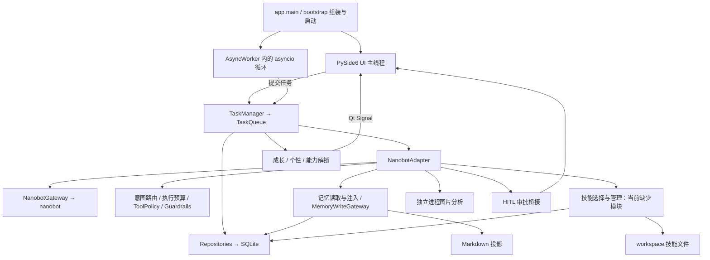

# Lobuddy 项目整体扫描预览

扫描日期：2026-10-16（Asia/Shanghai）。源码基线：`main` / `9a27479`。

## 1. 总体判断

Lobuddy 是一个 Python + PySide6 的本地桌面 AI 助手，以桌宠、陪伴和成长反馈承载聊天及工具执行。它已经具有较丰富的产品功能和安全控制代码，但当前检出不能直接作为“已验证可运行的完整版本”。优先障碍是技能源码缺失、nanobot 子模块未初始化、本机依赖不完整；本地应用打开能力还存在明确的平台限制。

这是目录与 Git 盘点、关键调用链阅读、静态导入核对和有限本地冒烟检查，不是全量代码审计、渗透测试或跨平台验收。未安装依赖、拉取子模块、调用外部模型或启动 GUI；未读取真实用户记忆内容或凭据。

## 2. 当前版本与规模

| 项目 | 本次观察 |
|---|---|
| 分支 / HEAD | `main` / `9a27479` |
| 最近提交 | 2026-05-07 18:52 +08:00；修复启动报错、优化 HITL 弹框、记忆/技能面板接线 |
| 初始工作区 | 无未提交、已暂存变更 |
| 发布元数据 | `pyproject.toml`：`0.1.0`，Alpha，Python >=3.11 |
| Python 环境 | `python` 为 3.12.7；`python3` 为系统 3.9.6，后者低于项目最低要求 |
| 应用源码 | `app/`、`core/`、`ui/` 合计 118 个 Python 文件，19,353 行，含空行和注释 |
| 测试目录 | 62 个 Python 文件，其中 58 个 `test_*.py`；AST 统计 684 个 `test_` 函数/方法定义 |
| 配置规模 | `Settings.model_fields`：142 个字段 |
| nanobot | Git 固定到 `04a41e31ac421c00f62d971867c04c2a1ec8ec68`；本地目录为空，子模块状态前缀为 `-` |
| 自动化与锁定 | 主仓库未跟踪 `.github/` 工作流或依赖锁文件；不能据此排除仓库外 CI |

684 是源码定义数，不是 pytest 收集结果或通过数量；参数化、跳过和导入错误都会影响实际执行数。未查询远端，因此这里的版本状态只代表本地检出。

| 目录 | Python 文件数 / 行数 | 内容 |
|---|---:|---|
| `app/` | 5 / 1,196 | 启动、配置覆盖、健康检查、Qt 和异步运行时组装 |
| `core/` | 94 / 12,300 | Agent、任务、记忆、技能、成长、持久化、安全和执行治理 |
| `ui/` | 19 / 5,857 | 桌宠、聊天、设置、托盘、主题、时间轴、人工审批 |
| `tests/` | 62 / 11,867 | 单元/集成/回归测试及独立功能验证脚本 |
| `scripts/` | 4 / 408 | 诊断、功能冒烟和基线评估 |

`plan_/` 保存历史设计与修复计划，`reports/` 保存分析材料，`data/` 有部分被跟踪的资产及记忆文件。`workspace/`、日志和运行时数据库主要由启动流程创建。

## 3. 产品内容与实现状态

| 能力 | 代码中的实现 | 本次确认程度 |
|---|---|---|
| 桌宠和陪伴 | 无边框窗口、拖动、GIF、状态文字、时间、问候、自定义外观 | 实现和接线可见；未运行 GUI |
| 对话和任务 | 多会话、消息持久化、串行任务队列、任务卡片、时间轴 | 主调用链可见；未执行真实模型任务 |
| 成长系统 | 经验、等级、进化、五维个性、能力解锁 | 模型和服务存在；宠物存取冒烟通过 |
| 专注模式 | 专注/休息、暂停/继续、倒计时及桌宠反馈 | `FocusCompanion` 与 UI 接线可见 |
| 主题和设置 | 预设/自定义主题、图片配色、环境配置、数据库覆盖 | 实现可见；142 个配置字段 |
| 图片分析 | 文件校验、Pillow 处理、独立子进程、多模态配置 | 实现可见；未启动子进程或模型 |
| 长期记忆 | 类型化记忆、统一写入入口、来源信息、预算、选择/投影、维护 | 写入和注入调用链可见；空库检索冒烟通过 |
| 历史检索 | `session_search` 工具、会话范围和输出预算 | 注册/清理代码与测试存在；未运行集成测试 |
| 技能管理 | SQLite 生命周期、技能文件投影、面板、维护/使用反馈接口 | 核心依赖模块缺失，不能认定闭环可用 |
| 执行治理 | 意图路由、调用次数预算、路径/命令约束、结果长度限制、执行轨迹 | 部分纯逻辑冒烟通过；完整链路未验证 |
| 人工审批（HITL） | 危险命令分类、Qt 确认、超时拒绝、审批日志 | 分类及失败拒绝逻辑冒烟通过；弹窗未验证 |
| 本地应用打开 | 候选查找、候选路径校验、系统打开 | 偏 Windows 实现；已复现 macOS 无法打开 |

## 4. 架构与主链路

一次普通任务大致经过：用户输入 → 保存聊天/任务 → FIFO 排队 → 记忆与技能上下文注入 → 意图路由与工具约束 → nanobot 执行 → 工具需要时请求人工确认 → 保存结果 → 经验/个性/能力反馈 → 更新 UI。

架构有明确的组织边界：`app/` 是组装入口，`ui/` 是界面，`core/` 集中业务能力。它不是完全隔离的纯领域架构：任务层直接依赖 Qt 的 `QObject/Signal`，界面也直接使用部分 Repository。`EventBus` 用于部分内部事件，主要 UI 通知仍为 Qt Signal。

`NanobotAdapter` 汇总任务前后处理，`NanobotGateway` 集中访问 nanobot 的 `_loop`、`_process_message` 等内部接口。这缩小了外部框架变动的影响面，但不消除版本兼容风险；恢复子模块时应先使用仓库记录的提交。

SQLite 是业务主存：宠物、任务/结果、设置、主题、能力、会话/消息、记忆/摘要、技能/事件、执行轨迹、审批日志。Schema 在数据库和各 Repository 初始化时创建，存在增列逻辑，无独立版本化迁移框架。数据库管理器是全局共享对象，但每次 `get_connection()` 都建立新连接，不是所有线程共用同一个连接。

其他存储包括外观 JSON、记忆 Markdown 投影、技能文件，以及交由 nanobot 管理的会话数据。由于子模块为空，本次没有验证 nanobot 内部持久化实现。

## 5. 问题与风险清单

P1 表示应优先处理的运行/发布或凭据保护问题，P2 表示后续可靠性与维护问题。本次仅记录，未实施功能修复。

| ID / 优先级 | 问题及证据 | 当前行为（修复前） | 建议方案 | 预期修复后行为 | 风险：不处理 / 修复 | 状态 |
|---|---|---|---|---|---|---|
| S01 / P1 | 缺少 `skill_schema.py`、`skill_selector.py`、`skill_candidate_extractor.py`、`skill_validator.py`；`SkillManager` 顶层导入前者。`.gitignore:56` 的 `skills/` 匹配 `core/skills/` 下新文件 | **实测**四模块导入失败，`SkillManager` 也报缺少 schema；主 UI 初始化依赖 SkillManager，运行环境补齐后仍会遇到此障碍 | 从原环境或可靠历史恢复真实实现，核对测试契约；若意图仅忽略根目录技能，则收窄为 `/skills/`，验证 Git 跟踪完整性 | 全新检出能导入技能模块、启动面板并收集相关测试 | 不处理：启动/测试受阻；修复：恢复错版本会造成接口不一致 | 文件缺失与忽略匹配已证实；“误忽略导致漏提交”是待历史证据确认的假设 |
| S02 / P1 | 子模块为空；当前 Python 3.12 环境缺少 PySide6、nanobot、markdown、pytest、ruff、black、mypy；系统 python3 为 3.9 | **实测**依赖探测及开发工具调用失败；当前环境不足以启动桌面主流程 | 建立 >=3.11 的隔离环境，初始化固定提交的子模块，再安装主项目和开发依赖 | 用同一解释器运行启动、健康检查和验证工具 | 不处理：无法判定集成质量；修复：未固定版本可能引入漂移 | 环境阻塞；未安装或拉取 |
| S03 / P1 | `local_open_tool.py` 只调用 `os.startfile`；resolver 主要搜索 Windows 开始菜单及 `.lnk/.url/.exe` | **实测**在 macOS 给定合法候选和存在的临时文件，返回 `os_startfile_not_available` | 明确能力的平台范围；若继续承诺该能力跨平台，再添加 macOS/Linux 的查找与打开实现 | 支持的平台可以完成候选查找与打开；不支持时提前清晰提示 | 不处理：跨平台用户执行失败；修复：新增系统调用须保留候选及路径验证 | 平台限制已复现；未修复 |
| S04 / P1 | `ui/task_panel.py` 必须导入 `markdown`，日志必须导入 `loguru`，热键使用 `pynput`；主项目未声明这三项；README 覆盖率命令所需 pytest-cov 也未列入 dev | 依赖传递安装或环境偶然已有；markdown 缺失时聊天面板导入失败，pynput 缺失时热键降级 | 核对固定 nanobot 的依赖，再显式声明直接依赖；决定热键是必需还是可选，并补充对应安装说明 | 干净环境获得可重复的功能集和开发工具 | 不处理：换机或上游依赖变化后失效；修复：版本与系统权限兼容需验证 | 声明缺口已确认；未断言完整 pip 安装一定失败 |
| S05 / P1 | `core/storage/crypto.py` 用用户名/主机名与固定字符串派生密钥，再重复 XOR + Base64；设置仓库用于保存 API Key | **源码证据**为可逆混淆；知道派生信息即可重建密钥，不能视作可靠凭据保险库 | 优先评估系统凭据存储；明确旧 `enc:v1:` 数据迁移与失败回退策略 | 密钥材料不再仅由可预测机器信息派生，旧配置平滑迁移 | 不处理：数据库拷贝泄露后的保护弱；修复：迁移不当可能丢失已保存配置 | 静态确认；未访问真实凭据 |
| S06 / P2 | `app/main.py` 的 QTimer 在主线程直接调用记忆/技能维护；维护包含同步数据库/文件操作 | **源码证据**维护占用主线程；数据增长可能引起界面卡顿，尚未测量延迟 | 先用代表性数据测量；若超出交互预算，将维护移至工作线程并通过信号回传 | 维护期间界面保持响应 | 不处理：数据量增长时卡顿；修复：并发访问与退出取消需要验证 | 主线程调用已确认；卡顿程度待测 |
| S07 / P2 | README 仍写 224 测试及旧 Stage；AGENTS 的文件/规模统计与当前代码不同 | 文档不能准确反映现有技能、记忆、执行治理、HITL 及运行障碍 | 基于可重复检查刷新概览，区分源码已实现、测试通过和待验收 | 新维护者获得与当前检出一致的导航和成熟度说明 | 不处理：误判完成度；修复：纯文档低风险，但不要手填虚假的通过数 | 已确认；本报告提供快照，未改历史文档 |
| S08 / P2 | 主仓库未跟踪 CI 工作流或依赖锁定文件；现有测试本次无法执行 | 缺少本仓库可见的自动验证和稳定依赖解析证据；不能证明近期提交全绿 | 在修复启动阻塞后建立最小 CI：源码完整性、关键回归、静态检查；再逐步覆盖平台 | 新提交自动暴露缺文件、导入失败和关键回归 | 不处理：依赖漂移/回归发现晚；修复：需处理 Qt 无头运行和不同平台条件 | 仓库内缺口已确认；仓库外 CI 未调查 |
| S09 / P2 | Git 跟踪两个 `core/skills/__pycache__/*.pyc` 及 `data/memory/USER.md.bak`；`.gitignore` 只精确忽略 USER.md；迁移代码会创建该备份 | 运行产物进入版本库；用户画像备份存在泄露风险，**未检查内容，未认定含真实隐私** | 核实数据归属，使用普通提交移除不应跟踪的运行产物并补匹配；如确有敏感历史另行评估处理 | 新备份/字节码不再进入提交；必要示例使用合成数据 | 不处理：噪声及潜在数据暴露；修复：误删示例或测试资产；移除当前文件不清除历史 | 跟踪状态已确认；内容与历史风险待核实 |

## 6. 本次验证记录

未修复代码，因此下表记录当前基线观察，不提供虚构的“修复后通过”结果。下一阶段的验收目标见问题表。

| 关联 ID | 检查任务与步骤/命令 | 预期或判断标准 | 实际结果与证据 | 执行状态 |
|---|---|---|---|---|
| S01 | `git ls-tree -r --name-only HEAD core/skills`；`git check-ignore -v --no-index core/skills/skill_schema.py`，并检查其余三模块；用 `importlib.import_module` 导入 | 区分源码缺失、导入链错误和忽略匹配 | 4 个文件缺失；均匹配第 56 行；SkillManager 导入报 `ModuleNotFoundError: core.skills.skill_schema` | 已执行，确认缺陷 |
| S02 | `git submodule status`；解释器版本与 `importlib.util.find_spec` | nanobot 子模块与必要包可用，Python >=3.11 | 子模块状态 `-04a41e…`；python=3.12.7，python3=3.9.6；依赖缺口见 S02 | 已执行，确认环境阻塞 |
| S02 / S08 | `python -m pytest --version`、`python -m ruff --version`、`python -m black --version`、`python -m mypy --version` | 开发工具可调用 | 四项均 `No module named ...`；未执行测试套件、lint、格式或类型检查 | 工具探测已执行；质量门禁受阻 |
| S03 | `python -B`：确认无 os.startfile，创建临时 txt，注入合法候选，调用 `LocalOpenTool.execute` | 在该平台应返回明确的不支持结果，而非伪报成功 | `opened=false`，`reason=os_startfile_not_available`；没有打开任何应用 | 已执行，确认能力限制 |
| S04 / S07 / S08 / S09 | 核对 pyproject、README、代码导入、`git ls-files` | 声明/文档/跟踪状态与源码一致 | 确认表列缺口；未读取画像备份内容 | 已执行，静态证据 |
| S05 / S06 | 阅读 crypto、settings_repo、QTimer 维护接线和维护函数 | 明确凭据保护机制、操作所在线程及风险边界 | 确认可预测派生 + XOR，确认维护同步运行；未实测攻击或界面耗时 | 静态检查完成；动态风险评估未执行 |
| 通用 | `python -B` + `ast.parse`；扫描 app/core/ui/tests/scripts 及根目录 test_hitl_feature.py | 所有现存 Python 文件语法可解析 | 185 / 185 通过；不代表缺失模块、依赖或类型问题通过 | 已执行，通过 |
| 通用 | TemporaryDirectory 内创建 Settings/Database，连续初始化两次；PetRepository 写入/读取；MemoryRepository 空库检索 | 建表幂等、宠物读写一致、空查询返回 [] | 全部断言通过；当前 SQLite FTS5 可用；未触碰真实数据库 | 已执行，通过 |
| 通用 | 路由“打开微信”“讲个笑话”和空字符串 | 分别为本地打开、一般对话、一般对话 | 3 个用例通过 | 已执行，通过 |
| 通用 | ToolPolicy 分类 `ls -la`、`rm temp.txt`、`ls; rm temp.txt`，仅处理字符串 | 分别 ALLOW、HITL_REQUIRED、DENY | 3 个用例通过，未执行任何待分类命令 | 已执行，通过 |
| 通用 | 用默认拒绝 provider 和抛错的合成 provider 调用审批封装 | 不可用或异常时拒绝，保留请求归属 | 2 个用例通过；未测试真实弹框和超时等待 | 已执行，通过 |
| 集成 | GUI、真实 LLM、图片子进程、Windows/Linux、退出流程、安装包 | 端到端功能和平台兼容性 | 当前环境及范围不足，未执行 | 未验证 |

## 7. 后续优先顺序与优化建议

1. **先恢复可运行基线**：处理 S01/S02，并核对 S04。成本主要在找回真实技能源码和重建固定依赖环境；收益是能够开始可信的集成测试。不要用空类或占位实现填补缺文件。
2. **再确定支持范围与安全基线**：处理 S03/S05；至少明确本地打开的 Windows 限制，并为凭据存储制定兼容迁移方案。这些属于对应问题的必要修复或产品范围澄清。
3. **建立回归证据**：优先跑技能、记忆写入边界、执行治理、HITL、任务持久化和退出测试，然后运行全量测试及静态检查。建立最小 CI 的收益是避免再次发布缺文件的检出。
4. **按测量结果优化维护任务**：S06 的线程调整需要投入并发/关闭回归验证；先测量可以避免无依据地扩大改造。
5. **逐步降低核心大文件的维护成本**：`settings_window.py` 1,312 行、`nanobot_adapter.py` 1,142 行、`task_panel.py` 924 行、`app/main.py` 646 行。后续随功能修改按责任提取组件有价值，但这不是修复当前启动阻塞的前置条件，不建议仅因文件长而整体重写。

本次新增报告与一条可复用排查经验，未修改产品源码、依赖、Git 忽略规则或运行配置。经验见 [目录忽略与源码缺失](../docs/experience/patterns/broad-directory-ignore.md)。
