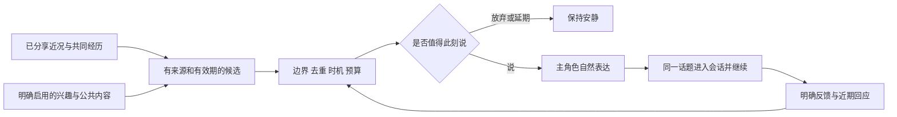

# 五个陪伴项目调研与 Lobuddy 下一步

日期：2026-10-28，Asia/Shanghai。Lobuddy 源码基线为 `6168928`，前次分析提交为 `61c2be6`。本次是公开仓库、官方文档、关键调用链和测试源码的静态研究；没有安装或运行这五个产品，没有执行其测试，不能据此判定真实模型自然度、长期稳定性或平台兼容性。

用户已明确：优先改善“她更会主动找话题、自然陪伴”；内容同时包括“续接近况”和“符合兴趣的新鲜事”。本报告据此调整[前次扫描](2026-10-28_product_state_and_evolution.md)的实施顺序：先完成主动陪伴的连续体验，再继续托付入口和工作流成长。以下方案仍为讨论稿，未修改运行代码、策略或权限。

## 研究结论

建议以 N.E.K.O. 的多来源选题、重复控制为主要参照，以 MaiBot 的交流节奏和 AIRI 的主角色接续方式补齐体验；LingChat 提供暂存与过期的实现参考，B 提供轻量桌面存在感参考。借鉴的是可解释的机制，保留 Lobuddy 的 TypeScript、DSH、来源记忆和受控执行架构。

产品终局可表述为：

> 她记得我们最近在聊什么，也能带来值得一起聊的新东西；你接话时她能继续，你忙时她会收住；经过相处，她的选题和表达越来越适合你。

这要求六件事协同成立：有可靠来源、有选择话题的理由、有合适的时机、有自然的表达、有连续的对话、能正确理解反馈。增加触发次数本身不能证明陪伴质量提高。

## 固定研究快照

Star 为本次 GitHub API 查询值，会继续变化；许可证字段来自仓库元数据，只记录标识，本轮不复制或集成外部代码。

| 项目 | Star | 许可证标识 | 固定提交 |
|---|---:|---|---|
| [AIRI](https://github.com/moeru-ai/airi) | 50,829 | MIT | `dfd9453beaab3af43a40f9bdacebdcb0d51f2723` |
| [MaiBot](https://github.com/Mai-with-u/MaiBot) | 6,675 | GPL-3.0 | `6bcb2e068cd98793a132cb8cc4ebf3cc00cb8fc3` |
| [B](https://github.com/AhmadHassan-BTed/B) | 4,161 | MIT | `d34943d3ea89a9dbf2d0104e5ccf31c5696d35f4` |
| [N.E.K.O.](https://github.com/Project-N-E-K-O/N.E.K.O) | 3,128 | Apache-2.0 | `84fdb73ca643bd5ec752abd0e9f921308d8a59f0` |
| [LingChat](https://github.com/SlimeBoyOwO/LingChat) | 2,409 | AGPL-3.0 | `848fd3448c20ca32e0436a498d20e85f63393e7f` |

热度排序与用户提供的列表一致；借鉴优先级按本次产品目标排序，不按 Star 排序。

## 五个项目具体值得学什么

### AIRI：让后台发现回到同一个角色与对话

已确认的代码：后台 recipe 使用独立会话运行，结束后向主会话发送带来源标记的结果；主角色决定表达或保持安静。被取消的任务不回传结果。对应 [chat.ts](https://github.com/moeru-ai/airi/blob/dfd9453beaab3af43a40f9bdacebdcb0d51f2723/packages/stage-ui/src/stores/chat.ts#L414) 与[后台任务测试源码](https://github.com/moeru-ai/airi/blob/dfd9453beaab3af43a40f9bdacebdcb0d51f2723/packages/stage-ui/src/stores/chat-background-tasks.browser.test.ts)。测试已阅读，未在本轮执行。

需要校正成熟度：[ADR](https://github.com/moeru-ai/airi/blob/dfd9453beaab3af43a40f9bdacebdcb0d51f2723/docs/ai/adr/2026-10-10-skills-automations-and-memory.md)描述沉默、时间、重新活动等 automation，且列有真实模型、Discord、语音尚未验证。本轮检查的 [recipe 类型](https://github.com/moeru-ai/airi/blob/dfd9453beaab3af43a40f9bdacebdcb0d51f2723/packages/core-agent/src/runtime/recipe.ts)、导出和界面调用链没有确认这套 automation 接入；`builtIn_armRecipe` 的仓库代码搜索仅命中 ADR，`checkAutomations` 仅命中 README。搜索结果不是整个项目不存在功能的证明，足以说明“文档描述”不能直接写成“当前版本已运行验证”。

Lobuddy 可学：准备素材与对用户说话分开，主角色承担最终表达，话题及来源留在后续对话可用的上下文中。AIRI recipe 使用注册工具集的授权方式不直接迁入 Lobuddy；继续使用既有能力边界和审批。

### MaiBot：先决定参与，再决定怎么说

[调度代码](https://github.com/Mai-with-u/MaiBot/blob/6bcb2e068cd98793a132cb8cc4ebf3cc00cb8fc3/src/maisaka/turn_trigger/scheduler.py)先等消息批次收齐，再经过等待恢复、频率、强制触发、退避和动态门控。[群聊退避](https://github.com/Mai-with-u/MaiBot/blob/6bcb2e068cd98793a132cb8cc4ebf3cc00cb8fc3/src/maisaka/turn_trigger/idle_backoff.py)不等于所有私聊场景的主动降频；该调度入口没有待处理消息就返回，不能据此证明无人发消息时会主动关怀。

[规划提示](https://github.com/Mai-with-u/MaiBot/blob/6bcb2e068cd98793a132cb8cc4ebf3cc00cb8fc3/prompts/zh-CN/maisaka_chat.prompt)、[回复提示](https://github.com/Mai-with-u/MaiBot/blob/6bcb2e068cd98793a132cb8cc4ebf3cc00cb8fc3/prompts/zh-CN/maisaka_replyer.prompt)和[表达选择器](https://github.com/Mai-with-u/MaiBot/blob/6bcb2e068cd98793a132cb8cc4ebf3cc00cb8fc3/src/chat/replyer/maisaka_expression_selector.py)体现参与判断与表达风格的分工。自然度仍取决于模型、配置与真实使用，不能由提示词保证。

本体[插件源实现](https://github.com/Mai-with-u/MaiBot/blob/6bcb2e068cd98793a132cb8cc4ebf3cc00cb8fc3/src/plugin_market/sources.py)指向官方插件仓库；[目录快照](https://github.com/Mai-with-u/plugin-repo/blob/9c56a0d47ad800a4edb8e3f0e9c3195c8d09033a/plugins.json)确实列有 `WaterInk0101.proactive_private_chat` 等扩展。目录存在不代表默认安装启用，也不证明该插件与当前本体版本兼容；本轮没有安装验证。

Lobuddy 可学：允许用户连着说几句，短回应、分享、接续和沉默都是正常选择；倾诉时少追问，闲聊时不自动转成建议或任务。先通过不同输入和人工比较验证，再调整风格。

### B：轻量的观察、时机与桌面表达

[主动循环](https://github.com/AhmadHassan-BTed/B/blob/d34943d3ea89a9dbf2d0104e5ccf31c5696d35f4/brain/autonomy_loop.py)使用事件总线与屏幕上下文，普通模式随机约 3–7 分钟触发，高活动会暂停，corner 模式不触发；用户发言重置计时。例外是 work mode：约 15–30 秒，忽略普通 busy 判断。因此不能笼统声称所有模式都在用户专注时安静。

[角色状态](https://github.com/AhmadHassan-BTed/B/blob/d34943d3ea89a9dbf2d0104e5ccf31c5696d35f4/brain/soul.py)与[语言模型输出](https://github.com/AhmadHassan-BTed/B/blob/d34943d3ea89a9dbf2d0104e5ccf31c5696d35f4/brain/llm.py)衔接表情、语音和行为，适合研究可见的在场感。随机计时加温暖人设并不证明选题相关或长期理解用户。

Lobuddy 可学：把“安静陪着、准备说话、倾听”表达清楚。读屏、跨应用活动感知和更丰富角色形象留待单独验证与明确启用，当前主线用已分享信息和应用内状态即可推进。

### N.E.K.O.：最适合本轮的选题与反馈参照

[来源汇聚](https://github.com/Project-N-E-K-O/N.E.K.O/blob/84fdb73ca643bd5ec752abd0e9f921308d8a59f0/main_logic/proactive_chat/sources.py)覆盖屏幕、窗口、新闻、社区、视频、热点等可配置来源；[候选选择](https://github.com/Project-N-E-K-O/N.E.K.O/blob/84fdb73ca643bd5ec752abd0e9f921308d8a59f0/main_logic/proactive_chat/candidate_selection.py)交错多来源素材，避免某类素材占满候选。

[筛选提示](https://github.com/Project-N-E-K-O/N.E.K.O/blob/84fdb73ca643bd5ec752abd0e9f921308d8a59f0/config/prompts/prompts_proactive.py#L1073)先选值得聊的材料，再生成角色表达，允许没有合适材料时放弃。重复判断要求关注同一核心话题，换语气不算新话题。

[生成控制](https://github.com/Project-N-E-K-O/N.E.K.O/blob/84fdb73ca643bd5ec752abd0e9f921308d8a59f0/main_logic/proactive_chat/generation.py)结合明确话题指令、相似度和未回应记录处理重复；[未回应测试](https://github.com/Project-N-E-K-O/N.E.K.O/blob/84fdb73ca643bd5ec752abd0e9f921308d8a59f0/tests/unit/test_proactive_unanswered_repeat.py)包含有限重试后仍重复则放弃的场景。[交付代码](https://github.com/Project-N-E-K-O/N.E.K.O/blob/84fdb73ca643bd5ec752abd0e9f921308d8a59f0/main_logic/proactive_chat/delivery.py)还检查发送时的有效性。测试源码存在不等于本轮已测通过。

Lobuddy 可学：近况和新鲜事共享候选池，按相关性、新意、来源有效性和近期打扰情况选择；已经没回应的话题不要换句话追问。首版只接少数明确启用的公共来源，复用现有受控读取，不整套搬入其平台和多阶段复杂度。

### LingChat：想开口与此刻能开口分开

当前快照是 Rust/Tauri 实现。[主动系统](https://github.com/SlimeBoyOwO/LingChat/blob/848fd3448c20ca32e0436a498d20e85f63393e7f/src-tauri/src/ai_service/proactive_system/mod.rs)维护待投放意图，按优先级和过期时间处理；[类型](https://github.com/SlimeBoyOwO/LingChat/blob/848fd3448c20ca32e0436a498d20e85f63393e7f/src-tauri/src/ai_service/proactive_system/types.rs)区分话题、屏幕、待办等。暂存队列是内存状态，不能当成重启可靠的持久安排。

[兴趣控制](https://github.com/SlimeBoyOwO/LingChat/blob/848fd3448c20ca32e0436a498d20e85f63393e7f/src-tauri/src/ai_service/proactive_system/interest_manager.rs)随主动次数降低上限，用户消息可恢复；这是调度参数，不证明真实情绪或人格成长。[策略分发](https://github.com/SlimeBoyOwO/LingChat/blob/848fd3448c20ca32e0436a498d20e85f63393e7f/src-tauri/src/ai_service/proactive_system/strategy_dispatcher.rs)按活动状态改变意图权重。

最终[投放评估器](https://github.com/SlimeBoyOwO/LingChat/blob/848fd3448c20ca32e0436a498d20e85f63393e7f/src-tauri/src/ai_service/proactive_system/delivery_evaluator.rs)实际只检查前端 `can_deliver`，尚未利用传入的意图类型和感知状态。因此活动影响前段选择，不等于最后一步已经具备丰富时机判断。

Lobuddy 可学：暂时不合适就延期，过时就放弃，用户开始讲话后再次拦截迟到内容。保留现有持久状态和来源校验，不用随机增长值冒充个性化。

## Lobuddy 已有基础与本轮差距

已存在：默认每天 3 次、间隔 60 分钟、忽略后冷却 120 分钟；应用内交流/输入、专注和运行中门控；同话题同版本七天内不重复；稍后、不再提、来源有效性和遗忘隔离；后台学习共享预算、前台抢占。来源分别见 [policy.ts](../packages/service/src/companion/policy.ts)、[topics.ts](../packages/service/src/companion/topics.ts)、[dialogue.ts](../packages/service/src/companion/dialogue.ts)、[learning.ts](../packages/service/src/knowledge/learning.ts)。这些无需另建一套。

以下沿用 LS 编号；LS-02/03 来自前次探针，其余为本轮静态发现。当前体验影响未测的部分明确标为预测。方案尚未实施。

| ID / 优先级 | 问题与证据 | 当前行为 / 修改前 | 建议方案 | 预期行为 / 修改后 | 风险与代价 | 状态 |
|---|---|---|---|---|---|---|
| LS-02 / P1 | 短句情景记忆额度与整句 LIKE 限制；前次报告有隔离探针 | 指定自然问句没取到已存事实；其他记忆路径不能一概而论 | 给召回独立有界额度，按项目/关键词/时间取相关候选，保留来源和作用域过滤 | “后来呢”等短句能结合已接续话题取得相关证据 | 不处理：反复解释；修复风险：错召回、增加成本 | 前次已复现；本轮复用，未修复 |
| LS-03 / P1 | 窄句式控制与固定表达；dialogue.ts:44–48、114；companion-state.ts | 明确指令改写可能漏建边界；模型只能从 3 个开头、4 个结尾及原文引用组合气泡 | 保守处理明确同义意图；事实引用与自然短表达分离；可选择不说 | 明确边界持续生效，话题能轻松开启而不反复背诵记录 | 不处理：生硬且边界易漏；修复风险：意图误判、事实漂移 | 状态差异前次复现；固定模板静态确认；自然度待测 |
| LS-10 / P1 | 气泡与后续会话缺少明确交接；companion.tsx:85、windows.ts:98、useDesktop.ts、dialogue.context | 点击执行 opened 并显示快速聊天；发消息只带所选 session/text，未携带邀请身份；该路径没有把邀请正文和来源加入会话。短句续接失败是预测，非已测模型结论 | 建立来源可重校验的会话交接，记录已展示的角色话语，区分后台素材与用户发言；幂等绑定目标会话 | 点气泡后回复“后来呢”，知道在接哪件事；跨项目不串话；重复点击不重复入历史 | 不处理：搭话与聊天脱节；修复风险：会话错绑、旧来源复活、双重入账 | 调用链静态确认；原生与模型续接待测 |
| LS-11 / P1（产品缺口） | 主动来源只取有效项目/记忆；enqueue 选择首个合格来源；无候选时 poll 回退通用邀请 | 已有受控网页工具，但本轮所查主动管线没有兴趣发现消费者，也没有多候选质量比较或显式放弃结果 | 小规模近况/新鲜事候选池，先过滤后评估；显式 speak/defer/pass；无有效素材就安静 | 两类内容都可出现，带新消息有真实可访问来源；候选不够好可零发言 | 不处理：难有用户要的新鲜感；新增风险：网络失败、过期内容、提示注入、费用，须保留工具治理 | 静态确认；属新增能力，未接入 |
| LS-12 / P2 | UI活动、邀请点击和兴趣反馈没有完整区分；policy.engage/feedback、topics.feedback | 任何应用内打字/聊天可清除邀请并标 opened；opened 本身不更新偏好，later/ignored 同走冷却，没有基于回应的选题学习 | 区分显示、进入会话、实际续接、明确喜欢/不喜欢与未回应；以明确反馈为强信号，未回应只做短期降频 | 能渐进改善选题；不会因为打开窗口就认定喜欢，也不会因为忙而永久厌弃话题 | 不处理：适应性难证明；新增风险：误学偏好、过度记录；只存必要有界事件，允许纠正 | 静态确认；当前并非已存在“把点击学成喜欢”的错误 |

## 建议的一个完整里程碑

目标：**她能围绕近况或兴趣主动说一句，你接话后自然聊下去；不回应或表示暂时不聊时，她能适当地收住。**

按三个可单独复核的小阶段实施，均服务同一个里程碑：

1. **先打通接话与边界（LS-02/03/10）。** 用合成近况材料验证气泡→指定会话→连续两三轮；修复短句召回和明确边界改写。先保留现有布局、入口和频率。涉及契约的交接字段必须作为显式设计变更评审，不在本次研究中静默改动。
2. **接入两类选题（LS-11，并完成 LS-03 表达）。** 近况取未完话题、共同经历和仍有效的已分享信息；新鲜事取用户选定的少量兴趣及公开来源。先做一个可控的公共网页来源适配。候选均带来源、时间、主题、与兴趣的关系和有效期；在共享预算内比较，选择说、稍后、放弃，再生成有事实依据的一两句。两类内容不强制五五分；某天没有值得分享的新材料就不凑数。当前 analysis.run 不是已接通的网页发现工作流；新消费者须显式接入受控工具执行及其取消、限额、失败处理。
3. **让选择随反馈改善（LS-12）。** 先用可解释的明确偏好与有界近期记录调整，观察未回应后的频率和重复；有新角度、有新进展才考虑重提。固定质量基线后再由用户调节积极程度。长期偏好写入继续走 MemoryWriteGateway；不以发言次数或停留时长作为唯一优化目标。

简单流程：

例子仅为设计场景，非已发生事实：

- 续接近况：你之前聊到某次演示，她在合适时机问起结果；你说“比预想顺利”，她能接着聊那个演示，而不是重新询问背景。
- 兴趣发现：有可信来源发布了与你明确兴趣有关的新作品，她用自己的表达分享一个具体亮点；你追问时能给出处，查不到时如实说。
- 安静陪伴：你说“今天不想聊工作”，她不再主动提工作；你没有回应一条分享，她不会连续改写同一件事催你。

本轮必要成本是会话交接、来源与候选生命周期、受控网页读取及质量评估。更换基础架构、直接接入五个项目运行时、Live2D/3D、全量读屏、多平台社交账号和更广自动执行不属于这个里程碑。后续丰富形象与声音的价值是增强存在感；前提是核心交流连续性成立，且语音发布门槛单独通过。

## 实施前确定的验收

这是后续验收定义，不是本轮运行结果；不预设自然度一定改善。

| ID | 测试任务 / 步骤 | 修改前结果 | 修改后期望 | 实际结果与证据 | 状态 |
|---|---|---|---|---|---|
| LS-02 | 使用前次短句探针，增加已接受话题、无关项目、纠正/遗忘来源 | 前次观察：关键词命中但情景上下文未含目标；新增边界为预测 | 相关事实有界入上下文，无关/失效来源排除 | 本轮只复用报告，不重复运行 | 修复验收未执行 |
| LS-03 | 明确指令的前后文、同义改写、引用、假设、取消边界；同素材比较自然表达与固定模板 | 前次观察：指定改写状态不一致；自然度未测 | 确定性边界用例通过；人工比较事实正确、自然和追问负担 | 本轮确认固定模板限制 | 修复验收未执行 |
| LS-10 | 原生点击气泡后输入“后来呢”；多会话、重复点击、气泡过期、来源删除再点；连续三轮 | 预测：缺少显式邀请上下文，模型未必知道指代 | 原话/来源关联正确且不重复；失效来源不重用；三轮无须重讲背景 | 静态检查确认没有交接字段或该路径的历史写入；未测真实回答 | 原生/模型验收未执行 |
| LS-11 | 固定素材：近况、新鲜事、重复改写、过期、低相关、恶意网页、空结果；发言前进入输入/专注 | 观察：所查管线无外部发现消费者；无主题回退通用气泡 | 两类高质量候选可选；空/过期/重复可放弃；迟到结果不抢话；不可扩大工具权限 | 既有受控 web 工具存在，不代表新消费者已实现 | 新流程验收未执行 |
| LS-12 | 展示后不回应、仅打开窗口、真实续接、稍后、不再提、撤销偏好；重启后复核 | 观察：活动可能记 opened；现有 opened 不学习偏好 | 各信号含义分开；忙不永久封禁；明确不再提有效且可撤销 | 当前反馈逻辑已读，未做新增事件实验 | 新学习验收未执行 |
| LS-02/03/10–12 | 实现后运行 `npm run check`，隔离原生/真实模型场景，记录来源正确与重复等案例 | 前次源码标准检查 254 通过，不覆盖新增语义目标 | 工程门禁通过，模型和产品验收另列实际证据 | 本轮没有重跑标准检查 | 实施后执行 |
| LS-03/10–12 | 建议连续 3–7 天自愿试用；记录选题理由、来源、是否接话、是否烦扰、是否需要重讲及调用成本 | 无可比的真人基线 | 相同频率下更愿意接话、更少重讲，未回应后不追催；阈值在基线后确定 | 未开展试用，未创建定时任务 | 人工待验收 |

本次交付验证：核对固定 GitHub 提交、关键实现/调用点/测试源码及本地相应模块；25 个固定提交链接均与已取回的仓库树和 SHA 匹配，7 个本地链接均存在，`git diff --check` 通过。外部测试未执行，Lobuddy 原生交接尚未复现，LS-01 最终包与真人语音门槛继续独立待验收。

相关经验：本次复用[存储正确与召回准入的区别](../docs/experience/patterns/authoritative-knowledge-projections.md)，新增[主动话题交接与反馈语义](../docs/experience/patterns/proactive-conversation-continuity.md)。新记录的产品影响待原生/模型验证；不将静态证据写成运行通过。
